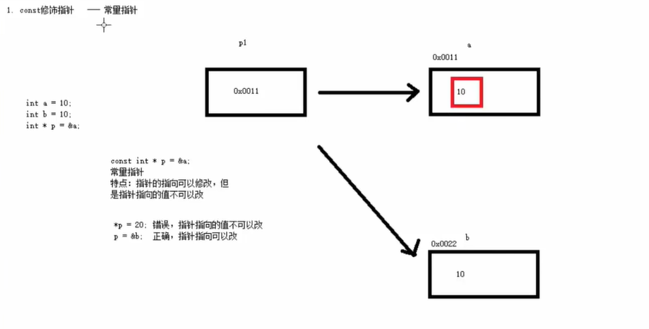
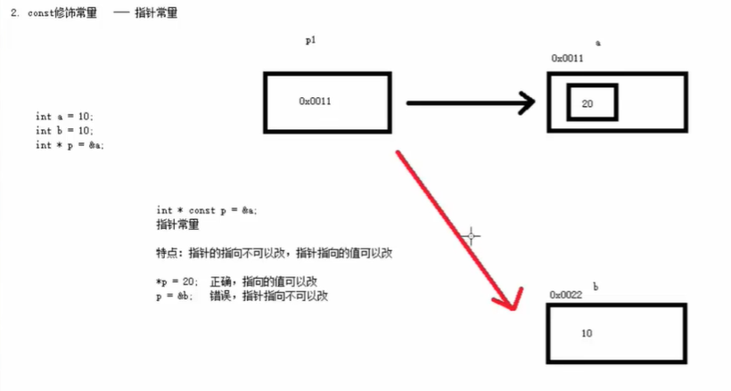

//三种情况：
//const修饰指针 ————常量指针 （在指针的前面加const就是）
//const修饰常量 ————指针常量
//const既修饰指针 ————又修饰常量

注：常量指针改地址，指针常量改数据

1.常量指针特点:指针的指向可以修改，但是指针指向的指不可以改

2.指针常量特点：指针的指向不可以改，指针指向的值可以改

3.既修饰指针 又修饰常量特点：指针指向和指针指向的值都不可以改

****const=常量（意思）、*是指针意思。。。。方便好记的点就这俩个来回换****
  *是指值  p是指指向